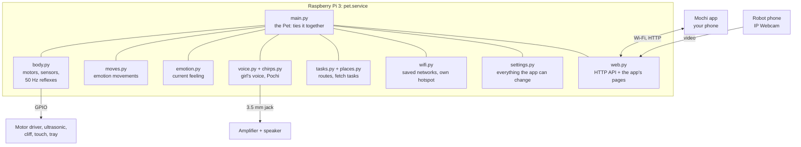

# Mochi: an autonomous pet rover

Mochi is a small anime-style pet on wheels. A **Raspberry Pi 3** is her brain, an **old Android phone** is her eyes,
and a cheap **2WD toy-motor chassis** is her body. She talks in two voices, shows her feelings by how she moves,
learns on her own, and fetches things from other rooms. Your own phone controls her through the **Mochi app**.

Everything runs locally on the Pi. She needs no account, no cloud and no subscription, and she never touches your
personal data.

| Document | What's in it |
|---|---|
| **This README** | The whole project: what she does, how it works, how to set her up, the app, the roadmap |
| [docs/HARDWARE.md](docs/HARDWARE.md) | Full hardware build: parts list, power, every pin, wiring per module, assembly, bring-up, calibration, troubleshooting |
| [docs/DESIGN.md](docs/DESIGN.md) | The design in depth: hardware limits, phone choice, machine learning, vision, add-ons, personality |

---

## Contents

1. [What she does](#what-she-does)
2. [Status](#status)
3. [How it works](#how-it-works)
4. [Hardware in short](#hardware-in-short)
5. [Setting it up](#setting-it-up)
6. [The Mochi app](#the-mochi-app)
7. [Teaching her and giving tasks](#teaching-her-and-giving-tasks)
8. [Wi-Fi anywhere](#wi-fi-anywhere)
9. [Voices and feelings](#voices-and-feelings)
10. [The mind: machine learning](#the-mind-machine-learning)
11. [Safety and privacy](#safety-and-privacy)
12. [Roadmap](#roadmap)
13. [Project layout](#project-layout)
14. [Developing on a PC](#developing-on-a-pc)
15. [Credits](#credits)

---

## What she does

**Works now** (written and tested in simulation; waiting for the real hardware):

- **Headless setup.** No screen, keyboard or mouse ever touches the Pi: flash the SD card, run one script on your PC,
  power on, and she installs herself.
- **The Mochi app** for Android: animated eyes that show her mood, joystick driving with her camera view, voice and
  typed requests, places and routes, Wi-Fi networks, and about 28 settings.
- **Fetch tasks:** "bring my remote from the bedroom". She drives there, asks whoever is there to put it on her tray,
  waits, and brings it back to you.
- **Wi-Fi anywhere:** saved networks for every place you go, and her own hotspot when she can't find one.
- **Two voices:** a girl's voice (Piper text-to-speech, pitched up to sound cute) and the "Pochi" voice, creature
  chirps whose melody follows her emotion.
- **Feelings in her movement:** happy wiggles, excited spins, angry shakes, sad back-offs, curious creeping, sleepy
  sways, loving nudges, and yes/no nods.
- **Reflexes:** a motor watchdog, obstacle stop, cliff (stairs) stop and back-off, all at 50 Hz on the Pi.

**Planned** (designed in [DESIGN.md](docs/DESIGN.md); see the [roadmap](#roadmap)):

- Wheel encoders and an IMU for routes that don't drift.
- Vision: following you around, line following, obstacle distance from the camera, recognising you and her own
  things.
- The wake word "Mochi" and spoken commands without your phone.
- A reinforcement-learning mind with drives, emotions, memory and nightly learning, so she grows her own habits.
- Smart-home control through a home assistant, add-ons that she detects herself, LiDAR, a charging dock, solar and a
  robot arm.

---

## Status

| Part | State |
|---|---|
| Design | Done ([DESIGN.md](docs/DESIGN.md)) |
| Hardware guide | Done ([HARDWARE.md](docs/HARDWARE.md)); parts not yet bought |
| Headless SD setup and first-boot installer | Written; tested on a fake card folder, not yet on a real Pi |
| Pet software, phase 0 and 0b | Written; tested in simulation on a PC |
| Android app | Built (21 KB APK); tested against the simulator, not yet on a phone |
| Phases 1-9 | Not started |

---

## How it works



- **One Python program** (`pet.service`) with small modules and no frameworks. It runs as its own `pet` user with
  no admin rights; its code is read-only to it.
- **The app is served by the Pi itself** (`web/`). The Android app is only a small shell that finds her and opens
  that page, so every pet update updates the app too.
- **Sensors and settings** live in `config.yaml`; changes from the app are saved on the Pi in
  `/var/lib/pet/settings.json`.
- **MQTT** (mosquitto) is installed for the later parts: add-ons, the home assistant and the phone all talk through it.

---

## Hardware in short

The full guide, with every wire, is [docs/HARDWARE.md](docs/HARDWARE.md).

| | |
|---|---|
| **Brain** | Raspberry Pi 3, 64 GB microSD, Raspberry Pi OS Lite 64-bit (Trixie) |
| **Eyes** | Lenovo K3 Note on the front, rear camera forward, streaming over Wi-Fi |
| **Body** | 2WD acrylic car kit with 2 TT gear motors and a caster |
| **Motor driver** | TB6612FNG (or L298N) |
| **Senses** | HC-SR04 ultrasonic, 2× TCRT5000 cliff sensors, TTP223 touch pad, tray microswitch; later 2 wheel encoders and an MPU6050 |
| **Voice** | Pi's 3.5 mm jack → PAM8403 amplifier → 3 W speaker |
| **Power** | 2-port power bank for the Pi and the phone; a **separate** motor battery (2× 18650 or 4× AA) with a kill switch |
| **Cost** | ≈ ₹2,000-3,000 for the parts beyond the Pi and phones |

### Pins (BCM)

| Function | Pins |
|---|---|
| Left motor (PWM, forward, backward) | 12, 5, 6 |
| Right motor (PWM, forward, backward) | 13, 20, 21 |
| TB6612 standby | 26 |
| Ultrasonic trigger / echo (echo through a 1k/2k divider) | 23 / 24 |
| Cliff sensors left / right | 16 / 25 |
| Touch pad | 22 |
| Tray switch | 19 |
| Wheel encoders (phase 1) | 17, 27 |
| **Reserved for add-ons**: I2C 2-3, SPI 7-11, UART 14-15, 1-Wire 4, PWM 18, ID EEPROM 0-1 | never used by the core |

---

## Setting it up

You need a Windows PC, the SD card, and the Pi. **No screen is ever connected to the Pi.**

### 1. Flash the card

Install [Raspberry Pi Imager](https://www.raspberrypi.com/software/) and write **Raspberry Pi OS Lite (64-bit)** for
**Raspberry Pi 3** to the card. Skip Imager's customisation; the next step does it.

### 2. Prepare the card

Leave the card in the PC. From this folder:

```powershell
powershell -ExecutionPolicy Bypass -File setup\prepare_sd.ps1
```

It finds the card's boot partition and asks, in your own terminal:
- your Wi-Fi name and password (2.4 GHz, WPA2 or WPA2/WPA3 mixed; the Pi 3 can't see 5 GHz),
- an optional backup network, such as your phone's hotspot,
- to create an SSH key if your PC has none.

It writes cloud-init files (hostname `mochi`, your login with the SSH key and no password, timezone, Wi-Fi, country),
turns on I2C, SPI and audio, and copies the pet's code onto the card. Options: `-Drive F:`, `-Hostname`, `-User`,
`-Country`, `-Timezone`.

**No card yet?** Build a folder now and paste it onto the card later:

```powershell
powershell -ExecutionPolicy Bypass -File setup\make_sd_folder.ps1 -Out D:\Mochi-SD-Card
```

The folder holds `pet`, `user-data`, `meta-data`, a `network-config` with placeholders, and a `README.txt` with the
steps. Once the card is flashed (step 1), type your Wi-Fi into `network-config` with Notepad, then copy those four
items onto the card's `bootfs` drive and replace the files it asks about. The first boot sets the Wi-Fi country, I2C,
SPI and audio itself.

### 3. First boot

Put the card in the Pi and power it from the power bank. The first boot installs everything by itself in about
15-30 minutes:
- system packages (Python, numpy, OpenCV, gpiozero, mosquitto, audio, NetworkManager tools),
- Piper and the default girl's voice,
- the `pet` user, the services, the Wi-Fi permission rule and the network name advert.

It retries until the internet is up, and wipes the Wi-Fi password from the boot partition and the logs afterwards.

**How to know it's ready without a screen:** the green LED blinks fast while installing and changes to a
**heartbeat** (double blink) when Mochi is running. If the speaker is wired you hear a chirp. On the PC:

```powershell
powershell -ExecutionPolicy Bypass -File setup\find_pet.ps1
```

finds her (`mochi.local`, or by the Pi's network ID) and shows the install log.

### 4. The app

Install `Mochi.apk` on your phone (build it with `android\build_apk.ps1`, see
[Developing on a PC](#developing-on-a-pc)). Open it: it finds Mochi on your Wi-Fi by itself. Any phone browser also
works at `http://mochi.local:8080`, without voice input.

### 5. Updates

After changing code on the PC:

```powershell
powershell -ExecutionPolicy Bypass -File setup\deploy.ps1
```

copies it over SSH and restarts her.

---

## The Mochi app

The design follows **anthropomorphic** ideas, kept abstract: soft rounded shapes, a head with two cat ears around
her eyes, and human gestures. Things squish when pressed, shake "no" when something fails and nod "yes" when it
works, her eyes glance at whatever you tap, and the logo and the online light blink like eyes. The colours are a
fresh mint and sea-teal with sunny-yellow touches; dark mode follows the phone.

| Tab | What's there |
|---|---|
| **Home** | Her **animated eyes** (blink, glance, happy ^^, angry lids, sad tear, hearts, sparkles, sleepy z's, a glow that pulses while she talks), what she just said, the current task with its buttons, **Ask her** (typed or spoken), feeling buttons, **Make her say**, status |
| **Drive** | Joystick and speed, the robot phone's camera view, a big STOP, the "teaching a route" banner |
| **Places** | Where she is and where you are, teach a route, places, routes, recent tasks |
| **Wi-Fi** | The current network, saved networks (connect, forget, priority), scan and add, her own hotspot on/off |
| **Settings** | Name and your name, voice, cuteness, voice speed, Pochi, volume, speeds, trim, sensor switches, camera address, task timings, hotspot; Restart Mochi |

The Android app itself is tiny (21 KB, no Gradle): it searches the last address, her hotspot (10.42.0.1),
`mochi.local` and the `_mochi._tcp` network service, adds Android speech recognition for the mic button, and keeps
the screen on.

---

## Teaching her and giving tasks

1. **Places tab:** add your rooms ("living room", "bedroom", "kitchen").
2. Set **where she is**, pick a destination, tap **Start teaching**, drive her there with the joystick, tap
   **Arrived**. She saves the wheel steps.
3. Every route also works backwards, and routes chain through other places (living room → hall → bedroom).
4. Ask, by typing or the mic: **"bring my remote from the bedroom"**, **"go to the kitchen"**, **"come here"**,
   **"stop"**.

On a fetch she:
- drives the route, and if the path is blocked says "Excuse me, can I get through?" and waits;
- asks whoever is there to put the remote on her tray, and asks again halfway through waiting;
- carries on when the tray switch is pressed, her head is patted, or you tap the app's button;
- drives back to the room you're in and says "Here's your remote!"

**Limit for now:** routes are timed wheel steps, so long routes drift with battery level and floor type. Short,
simple routes repeat well; re-teach a route if she misses. Wheel encoders (phase 1) and camera checks (phase 2) fix
this.

---

## Wi-Fi anywhere

- Add the Wi-Fi of every place ahead of time in the **Wi-Fi** tab, with a priority. She joins the best one in range
  by herself.
- With no known Wi-Fi for 90 s she starts her own hotspot, **Mochi-setup** (password `mochipet`; **change it in
  Settings**), and says so. Join it from your phone, open the app, and add the new place's Wi-Fi.
- While nobody is on her hotspot, she drops it for 45 s every 5 minutes to look for known networks again.
- Passwords stay in NetworkManager's root-only files on the Pi and are never shown again. The `pet` user only has
  permission to manage Wi-Fi, nothing else.

---

## Voices and feelings

- **Girl's voice:** Piper, `en_US-amy-medium` by default, with six other female English voices in Settings (each
  downloads itself the first time). **Cuteness** raises the pitch without speeding her up. Every sentence is cached,
  so repeats are instant.
- **Pochi voice:** chirps made in code, no recordings. Happy is fast rising trills, angry a low buzz, sad a falling
  whine, curious ends like a question, sleepy is a yawn, loving a soft warble. Pochi reacts first; the girl's voice
  speaks when she has something to say.
- **Body language:** there's no face on the robot. Her feelings are in how the car moves:

| Feeling | Movement |
|---|---|
| Happy | fast left-right wiggle |
| Excited | wiggle, full spin, wiggle |
| Angry | sharp forward/back shakes, then turns away |
| Sad | slow backing off, a small droop turn |
| Curious | creep, pause, creep, a little tilt |
| Sleepy | very slow small sways |
| Loving | slow approach, tiny wiggles, a gentle nudge |
| No / Yes | head-shake in place / small nods |

---

## The mind: machine learning

A Pi 3 has 1 GB of RAM and no AI chip, so instead of one big network Mochi gets many small learners, each doing one
job well (details in [DESIGN.md §5-6](docs/DESIGN.md#5-the-mind-machine-learning-all-of-it)):

| Learner | Method |
|---|---|
| Choosing what to do | a small actor-critic network (numpy), rewarded by praise, pats, needs met and curiosity |
| Curiosity | a forward model; surprise is the reward |
| Wake word "Mochi" | openWakeWord features + a personal classifier |
| Commands | Vosk (offline speech recognition) + a small intent classifier |
| People, and who is you | a person detector + a tracker, face and clothing-colour re-identification |
| Distance from the camera | a regressor trained on the ultrasonic sensor's readings as free labels |
| Free floor, places, routines | online models of the floor, a place graph, counts per hour of the week |
| Movement skills | cross-entropy method on move parameters, checked by the IMU and encoders |

She learns while she's charging at night by replaying the day, so she gets better overnight. Her drives (energy,
social, curiosity, boredom, sleepiness) and emotions push her to act on her own; your commands still come first.

---

## Safety and privacy

She is free to move, choose her behaviours, speak first, explore and learn. She can **never**:

- **Reach your data:** no accounts, passwords or tokens are on the pet. Anything outside (smart home, messages) goes
  through a home assistant that asks you first.
- **Change herself:** she runs as the `pet` user with no sudo, and her code is read-only to her. No arbitrary code;
  new drivers and skills need your OK.
- **Snoop:** the camera and mic stay on the pet; nothing is uploaded. Overheard speech is forgotten after 24 hours
  (planned with the voice phase). A firewall limited to your home network is planned (phase 7).
- **Hurt herself or others:** a 0.3 s motor watchdog, obstacle and cliff stops, a speed limit, and a hardware kill
  switch on the motor battery.

The Wi-Fi password you type in `prepare_sd.ps1` stays in your terminal and on the card, and is removed from the card
once she's online.

---

## Roadmap

| Phase | Result | Test | State |
|---|---|---|---|
| 0. Headless + bench | SD prep, first-boot install, motors, emotion moves, Pochi chirps | she drives, stops when the app closes, wiggles happy | written |
| 0b. App, Wi-Fi, voice, tasks | the app, eyes, settings, Wi-Fi, girl's voice, routes, fetch task | add a Wi-Fi from the app; teach a route; fetch the remote | written |
| 1. Safe body | ultrasonic, cliff, encoders, IMU, reflexes | stops at a table edge every time | partly written (ultrasonic, cliff) |
| 2. Eyes | phone stream, person detection and tracking, line following, distance from vision | follows you around the room | |
| 3. Voices + ears | wake word, offline speech recognition, Kokoro-made lines | 5 spoken commands | |
| 4. Emotions | drives and emotions driving moves and sounds | praise → happy wiggle, scold → angry shake | |
| 5. Mind | RL policy, memory, nightly learning, routines | greets you at the door after a few days | |
| 6. Skills | teach mode, practice, naming objects | "this is my cup" → later "find my cup" | |
| 7. Home + IoT | home-assistant link, firewall, phone alerts | "where's Mochi?" | |
| 8. Add-ons | auto-detect I2C/UART devices, drivers, policy growth | plug in a sensor and she uses it | |
| 9. Later | LiDAR, charging dock, solar, robot arm | charges herself; picks up a ball | |

---

## Project layout

```
config.yaml            default settings: name, pins, speeds, sensors, voice, Wi-Fi, ports
pet/                   the Python package (runs on the Pi)
  main.py              the Pet: commands from the app, status, startup (--sim for a PC)
  body.py              motors and sensors through gpiozero; 50 Hz reflexes and watchdog
  moves.py             emotion movements
  emotion.py           the current feeling (with time-of-day defaults)
  voice.py, audio.py   the girl's voice (Piper, cached) and the shared sound player
  chirps.py            the Pochi voice, synthesised
  tasks.py, places.py  fetch/go/come tasks; places, taught routes, route chaining
  wifi.py              saved networks, scanning, own hotspot (NetworkManager)
  settings.py          the settings the app may change, with validation
  web.py               HTTP API and the app's pages; camera proxy
  bus.py               MQTT link (for later phases)
web/                   the app's pages: index.html, style.css, app.js, eyes.js
android/               the Android shell app and its build script (no Gradle)
setup/                 prepare_sd.ps1, make_sd_folder.ps1, install.sh, services, find_pet.ps1, deploy.ps1
docs/                  HARDWARE.md, DESIGN.md
```

---

## Developing on a PC

**Run her in simulation** (fake pins, sound saved to a file instead of played). Needs Python 3.10+ with `pyyaml` and
`numpy`:

```powershell
pip install pyyaml numpy
```
```powershell
python -m pet.main --sim --port 8080
```

Then open <http://localhost:8080> in a browser. Driving, moves, places, routes, tasks, settings and a fake Wi-Fi
all work.

**Build the Android app** with `android\build_apk.ps1`. It needs a folder holding a JDK (`jdk-*`) and an Android
SDK with build-tools 35.0.0 (aapt2, d8, zipalign, apksigner) and `platforms\android-35\android.jar`:

```powershell
powershell -ExecutionPolicy Bypass -File android\build_apk.ps1 -Tools C:\path\to\android-tools
```

The output is `android\build\Mochi.apk`, signed with a debug key. On the phone, allow "install unknown apps".

---

## Credits

- [Piper](https://github.com/OHF-Voice/piper1-gpl) text-to-speech and the
  [rhasspy/piper-voices](https://huggingface.co/rhasspy/piper-voices) models (check each voice's model card for its
  licence).
- [gpiozero](https://gpiozero.readthedocs.io/), [NetworkManager](https://networkmanager.dev/),
  [Avahi](https://avahi.org/), [Mosquitto](https://mosquitto.org/), cloud-init.
- Fonts: [Poppins](https://fonts.google.com/specimen/Poppins) and [Lora](https://fonts.google.com/specimen/Lora)
  (SIL Open Font License), loaded from Google Fonts when online.
- Design ideas: OpenBot (phone-as-robot-brain mounting), Anki's robots (abstract anthropomorphic form).
