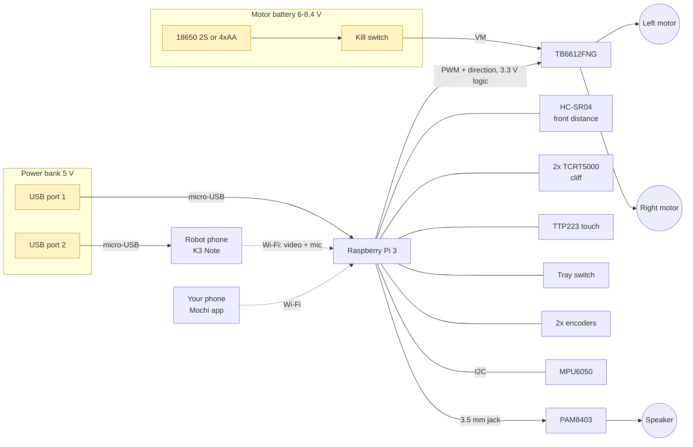

# Mochi: full hardware setup

How to build Mochi's body from parts, wire everything to the Raspberry Pi 3, and bring it up one piece at a time.
Pins and settings in this guide match the code (`config.yaml`, `pet/body.py`) as it is now.

> **Status.** The core wiring (motors, ultrasonic, cliff, touch, tray, speaker) is used by the current code. Wheel
> encoders and the MPU6050 are wired now so the body is complete, but the code that reads them comes in build
> phase 1 (see [DESIGN.md §12](DESIGN.md#12-build-phases)). Values marked *(measure)* are found on your own robot.

Contents:
1. [What you need](#1-what-you-need)
2. [How it fits together](#2-how-it-fits-together)
3. [Power](#3-power)
4. [The Pi's GPIO header: every pin](#4-the-pis-gpio-header-every-pin)
5. [Wiring, module by module](#5-wiring-module-by-module)
6. [Mechanical build](#6-mechanical-build)
7. [The robot phone (camera)](#7-the-robot-phone-camera)
8. [Bring-up: step by step](#8-bring-up-step-by-step)
9. [Calibration](#9-calibration)
10. [Troubleshooting](#10-troubleshooting)
11. [Safety](#11-safety)
12. [Later add-ons](#12-later-add-ons)

---

## 1. What you need

### Already have

| Part | Notes |
|---|---|
| Raspberry Pi 3 (Model B or B+) | The display output can be broken: the setup is headless. |
| microSD card, 64 GB | Class 10 / A1 or better. The whole card is erased when flashing. |
| Old Android phone (Lenovo K3 Note) | The camera and mic. Chosen over the Panasonic P101 in [DESIGN.md §2](DESIGN.md#2-which-phone-lenovo-k3-note). |
| Your own Android phone | Runs the Mochi app. |
| Windows PC | Prepares the SD card and builds the app. |

### To buy (India, online; prices are rough)

| # | Part | Qty | ≈ ₹ | Why |
|---|---|---|---|---|
| 1 | 2WD acrylic "smart car" kit (2 TT gear motors, 2 wheels, caster, plate, screws) | 1 | 300-450 | The body. Two driven wheels can spin on the spot, which the emotion moves need. |
| 2 | TB6612FNG motor driver module | 1 | 150-200 | Drives both motors. An L298N (≈₹120) also works with the same pins (§5.2). |
| 3 | Motor battery: 2× 18650 cells + 2S holder **with BMS**, **or** a 4×AA holder (often in the kit) | 1 set | 0-350 | Motors get their own battery (§3). |
| 4 | Small toggle or rocker switch | 1 | 20 | The motor kill switch. |
| 5 | Power bank, 10,000 mAh, **2 USB ports, ≥2.1 A each** | 1 | 700-1,000 | Powers the Pi and charges the robot phone. Skip if you have one. |
| 6 | Short micro-USB cables (thick, ≤30 cm) | 2 | 100 | Pi and phone. Thin long cables cause low-voltage resets. |
| 7 | HC-SR04 ultrasonic sensor | 1 | 60 | Front distance; also teaches vision to judge distance later. |
| 8 | Resistors 1 kΩ and 2 kΩ (or 2× 1 kΩ in series for 2 kΩ) | 1 each | 5 | Drops the HC-SR04's 5 V echo to 3.3 V for the Pi. |
| 9 | TCRT5000 IR reflective sensor module (with LM393 and a pot) | 2 | 80 | Cliff / stairs stop. |
| 10 | TTP223 capacitive touch module | 1 | 20 | Head pats. |
| 11 | Microswitch (lever type) | 1 | 20 | Under the tray: "something is on it". |
| 12 | LM393 slotted speed sensor module | 2 | 80 | Wheel encoders (phase 1). The kit's slotted discs go with them. |
| 13 | MPU6050 (GY-521) module | 1 | 130 | Turn angle, lifted/tipped detection (phase 1). |
| 14 | PAM8403 mini amplifier module | 1 | 40 | Speaker amp. |
| 15 | Speaker, 3 W, 4 Ω or 8 Ω, ~40-50 mm | 1 | 50 | Her voice. |
| 16 | 3.5 mm aux cable (to cut) | 1 | 30 | Pi audio jack → amplifier. |
| 17 | Capacitors: 0.1 µF ceramic ×2, 470 µF electrolytic ×2 | — | 20 | Motor noise and power smoothing. |
| 18 | Jumper wires (F-F, M-F, M-M), mini breadboard (170 holes) | 1 set | 150 | Connections without soldering. |
| 19 | M2.5 nylon standoffs + screws | 1 set | 80 | Mounting the Pi. |
| 20 | Phone holder (car/bike clip) or a foam-padded bracket | 1 | 50-150 | Front camera mount. |
| 21 | Round plastic food box (pastel), felt or cardboard for ears, small box for the tray | — | 100 | The shell and tray (§6.5). |
| | **Total** | | **≈ ₹2,000-3,000** | Less if you already have a power bank or 18650s. |

### Tools

- **Multimeter** (≈₹250). Strongly recommended: you check voltages before connecting the Pi.
- Small screwdrivers, wire stripper, side cutter.
- Hot glue gun, double-sided foam tape, zip ties.
- Soldering iron: optional. Everything here works with jumper wires; soldering the motor wires and switch makes the
  robot more reliable.
- A craft knife or a hot nail for cutting holes in the shell.

---

## 2. How it fits together



- **The Pi** runs everything: reflexes, the app, the voice, the mind.
- **The robot phone** streams its camera (and later its mic) to the Pi over Wi-Fi. It isn't wired to the Pi.
- **Your phone** controls Mochi through the app, over Wi-Fi or Mochi's own hotspot.
- **All grounds are joined** (§3.3). That's the one wire that connects the two power systems.

---

## 3. Power

### 3.1 Two separate supplies (the most important rule)

**Motors never run from the Pi's power bank.** A motor starting or stalling pulls a big current spike; on a shared
supply that dips the Pi's 5 V, the Pi resets, and a reset during a write can corrupt the SD card.

| Supply | Powers | Notes |
|---|---|---|
| **Power bank**, port 1 | Raspberry Pi 3 (and from its pins: the sensors, the amplifier) | Pi 3 needs a solid 5 V; 2.5 A is the official rating, real use here is ~0.6-1.2 A. |
| **Power bank**, port 2 | Robot phone charging | |
| **Motor battery** through the kill switch | TB6612 motor side (VM) only | |

### 3.2 Choosing the motor battery

| Option | Voltage | `max_speed` setting | Notes |
|---|---|---|---|
| 4× AA alkaline | 6.0 V new → 4.8 V | 1.0 | Easiest. Weak near the end. |
| 4× AA NiMH rechargeable | 4.8 V | 1.0 | A bit slow, but steady and rechargeable. |
| **2× 18650 Li-ion (2S)** | 8.4 V full → 7.4 V nominal → 6.0 V empty | **0.7** (default) | Best runtime and punch. TT motors are rated 3-6 V, so `max_speed` limits the average voltage. Use a holder **with a BMS** (protection board). |

Motor top speed is set in the app (**Settings → Driving → Top speed**), so changing battery is just a setting.

### 3.3 Common ground

Connect the **motor battery's negative (after the switch, same wire)** to a **Pi GND pin** through the TB6612's GND.
In practice: the TB6612 has GND pins on both sides; one goes to the battery −, one goes to a Pi GND pin. Without a
shared ground, the driver can't understand the Pi's signals.

### 3.4 The kill switch

Put the switch in the **+ wire** of the motor battery, before the TB6612's VM. Switch it off and the wheels cannot
move whatever the software does, while the Pi stays on. Use it when lifting Mochi, while wiring, and during the first
tests.

### 3.5 Runtime (rough)

- **Pi + phone on a 10,000 mAh bank:** ~31 Wh usable at 5 V ÷ (Pi ~3-4 W + phone charging ~2-3 W) ≈ **4-5 hours**.
- **Motors on 2× 2,600 mAh 18650s:** about **1.5-3 hours** of normal pottering (TT motors ~150-250 mA each while
  moving, more when pushing).

### 3.6 Checking the Pi's power

A lightning-bolt icon would show low voltage on a screen; with no screen, check over SSH:

```bash
vcgencmd get_throttled
```

`throttled=0x0` is good. Anything else (for example `0x50005`) means the supply or cable sagged: use a shorter,
thicker cable or the bank's stronger port.

> **Some power banks switch off** when the current is low. The Pi draws enough to keep most banks on; if yours
> turns off by itself, look for an "always on / low current" mode (often a double press of its button).

---

## 4. The Pi's GPIO header: every pin

Physical pin numbers are the header positions (pin 1 is the square pad, next to the SD-card end, on the inner row).
**BCM** is the GPIO number used in `config.yaml` and in this guide.

```
                 3V3  (1) (2)  5V
   I2C SDA  BCM 2     (3) (4)  5V          ← amplifier, HC-SR04
   I2C SCL  BCM 3     (5) (6)  GND
   1-Wire   BCM 4     (7) (8)  BCM 14 UART TX   (reserved)
                 GND  (9) (10) BCM 15 UART RX   (reserved)
 ENC left  BCM 17    (11) (12) BCM 18 spare PWM (reserved)
 ENC right BCM 27    (13) (14) GND
   TOUCH   BCM 22    (15) (16) BCM 23 US TRIG
                 3V3 (17) (18) BCM 24 US ECHO (via divider!)
  SPI MOSI BCM 10    (19) (20) GND
  SPI MISO BCM 9     (21) (22) BCM 25 CLIFF right
  SPI SCLK BCM 11    (23) (24) BCM 8  SPI CE0
                 GND (25) (26) BCM 7  SPI CE1
   ID_SD   BCM 0     (27) (28) BCM 1  ID_SC
   AIN1    BCM 5     (29) (30) GND
   AIN2    BCM 6     (31) (32) BCM 12 PWMA
   PWMB    BCM 13    (33) (34) GND
   TRAY    BCM 19    (35) (36) BCM 16 CLIFF left
   STBY    BCM 26    (37) (38) BCM 20 BIN1
                 GND (39) (40) BCM 21 BIN2
```

| BCM | Pin | Used for | Code |
|---|---|---|---|
| 12 | 32 | Left motor speed (TB6612 PWMA / L298N ENA) | `motors.left[0]` |
| 5 | 29 | Left motor forward (AIN1 / IN1) | `motors.left[1]` |
| 6 | 31 | Left motor backward (AIN2 / IN2) | `motors.left[2]` |
| 13 | 33 | Right motor speed (PWMB / ENB) | `motors.right[0]` |
| 20 | 38 | Right motor forward (BIN1 / IN3) | `motors.right[1]` |
| 21 | 40 | Right motor backward (BIN2 / IN4) | `motors.right[2]` |
| 26 | 37 | TB6612 STBY (not used with L298N) | `motors.standby` |
| 23 | 16 | HC-SR04 TRIG | `sensors.ultrasonic.trigger` |
| 24 | 18 | HC-SR04 ECHO **through the divider** | `sensors.ultrasonic.echo` |
| 16 | 36 | Cliff sensor, left | `sensors.cliff.pins[0]` |
| 25 | 22 | Cliff sensor, right | `sensors.cliff.pins[1]` |
| 22 | 15 | Touch pad | `sensors.touch.pin` |
| 19 | 35 | Tray microswitch | `sensors.tray.pin` |
| 17 | 11 | Left wheel encoder | phase 1 |
| 27 | 13 | Right wheel encoder | phase 1 |
| 2, 3 | 3, 5 | I2C: MPU6050 now, add-ons later | phase 1 |

**Reserved for add-ons, never used by the core:** BCM 0, 1 (HAT ID EEPROM), 4 (1-Wire), 7-11 (SPI), 14, 15
(UART: LiDAR), 18 (spare PWM). I2C (2, 3) is shared: the MPU6050 and any I2C add-on live on the same two wires.

**Power pins:** 3.3 V on pins 1 and 17 (keep the total under ~300 mA: fine for these sensors), 5 V on pins 2 and 4
(comes straight from the power bank), GND on 6, 9, 14, 20, 25, 30, 34, 39.

> **Never put 5 V on a GPIO pin.** The Pi's pins are 3.3 V only, with no protection. Every sensor below runs at
> 3.3 V except the HC-SR04, whose echo goes through a divider.

---

## 5. Wiring, module by module

Do every connection with **the Pi shut down and unplugged, and the motor switch off.**

### 5.1 TB6612FNG motor driver (recommended)

| TB6612 pin | Connect to |
|---|---|
| VM | Motor battery **+**, through the kill switch |
| VCC | Pi **3.3 V** (pin 1 or 17) |
| GND (motor side) | Motor battery **−** |
| GND (logic side) | Pi **GND** (for example pin 39) |
| PWMA | BCM 12 (pin 32) |
| AIN1 | BCM 5 (pin 29) |
| AIN2 | BCM 6 (pin 31) |
| PWMB | BCM 13 (pin 33) |
| BIN1 | BCM 20 (pin 38) |
| BIN2 | BCM 21 (pin 40) |
| STBY | BCM 26 (pin 37) |
| AO1, AO2 | Left motor's two wires |
| BO1, BO2 | Right motor's two wires |

- Put a **470 µF capacitor across VM and GND** (long leg / + to VM). It soaks up motor spikes.
- Solder a **0.1 µF ceramic capacitor across each motor's two terminals**, and twist each motor's two wires
  together. This cuts the electrical noise that can upset the Pi and the sensors.
- If a wheel turns the wrong way, don't rewire: flip it in the app (**Settings → Driving → Flip left/right wheel
  direction**).
- TB6612 limits: VM up to 13.5 V, 1.2 A per motor continuous. Two TT motors are well inside that.

### 5.2 L298N instead (if that's what you have)

| L298N pin | Connect to |
|---|---|
| +12V terminal | Motor battery **+** through the kill switch |
| GND terminal | Motor battery **−** **and** a Pi GND pin |
| 5V terminal | **Nothing.** Don't connect it to the Pi. |
| ENA (remove its jumper) | BCM 12 (pin 32) |
| IN1 / IN2 | BCM 5 / BCM 6 |
| ENB (remove its jumper) | BCM 13 (pin 33) |
| IN3 / IN4 | BCM 20 / BCM 21 |
| OUT1, OUT2 / OUT3, OUT4 | Left motor / right motor |

- Set **`motors.standby: null`** in `config.yaml` (no STBY pin).
- The L298N loses about 2 V inside itself, so with 4×AA the motors are slow: use 18650s and **Top speed 1.0**.

### 5.3 HC-SR04 ultrasonic (front distance)

| HC-SR04 | Connect to |
|---|---|
| VCC | Pi **5 V** (pin 2 or 4) |
| GND | Pi GND |
| TRIG | BCM 23 (pin 16), directly |
| ECHO | **1 kΩ** → BCM 24 (pin 18); and from BCM 24 **2 kΩ** → GND |

```
 ECHO ──[1 kΩ]──●── BCM 24 (pin 18)
                │
              [2 kΩ]
                │
               GND
```

ECHO outputs 5 V; the divider gives 5 × 2/(1+2) = 3.3 V. The echo is a short pulse that a multimeter can't read,
so double-check the resistor colours instead: 1 kΩ is brown-black-red, 2 kΩ is red-black-red.

Mount it at the front, centred, 5-8 cm above the floor, pointing straight ahead (§6.3). Mochi stops forward driving
when something is closer than **Settings → Sensors → Stop before obstacles** (15 cm by default).

### 5.4 TCRT5000 cliff sensors (×2)

| Module pin | Connect to |
|---|---|
| VCC | Pi 3.3 V |
| GND | Pi GND |
| DO (digital out) | Left: BCM 16 (pin 36). Right: BCM 25 (pin 22) |
| AO | not used |

- Mount them **under the front corners, ahead of the wheels**, facing straight down, **5-10 mm above the floor**.
- On most modules DO is **LOW over the floor** (IR bounces back) and **HIGH over a drop**. That's the default
  (`active_high: true`, **Settings → Sensors → Cliff sensor reads HIGH over a drop**). If yours is the other way
  round, flip that setting.
- Tune each module's blue pot: its LED should be **on over your floors** (including the darkest rug) and **off when
  lifted 3 cm**. Dark, shiny or black floors reflect less IR; test on all of yours.

When either sensor sees a drop: forward driving is refused, and Mochi backs off for 0.3 s.

### 5.5 TTP223 touch pad (head pats)

| TTP223 | Connect to |
|---|---|
| VCC | Pi 3.3 V |
| GND | Pi GND |
| I/O | BCM 22 (pin 15) |

Leave its A/B jumpers open (default: output HIGH while touched, no toggle). Glue it **inside the top of the shell**:
it senses through 1-2 mm of plastic, so the pat spot can be a sticker on the outside.

### 5.6 Tray microswitch

| Switch | Connect to |
|---|---|
| COM | Pi GND |
| NO (normally open) | BCM 19 (pin 35) |

The Pi's internal pull-up is used (`pull_up: true`), so no resistor is needed. **Pressed = something is on the
tray.** Mount the switch under a light hinged lid or tray floor so a TV remote (~60-100 g) presses it (§6.5).

### 5.7 Wheel encoders (×2, phase 1)

| LM393 speed module | Connect to |
|---|---|
| VCC | Pi 3.3 V |
| GND | Pi GND |
| DO | Left: BCM 17 (pin 11). Right: BCM 27 (pin 13) |

Fit the kit's slotted discs on the motors' inner shafts, and place each module so the disc spins through its slot
without touching. They let Mochi count wheel turns, so routes stop drifting with battery level. The code that reads
them is phase 1; wiring them now saves taking the robot apart again.

### 5.8 MPU6050 (phase 1)

| GY-521 | Connect to |
|---|---|
| VCC | Pi 3.3 V |
| GND | Pi GND |
| SDA | BCM 2 (pin 3) |
| SCL | BCM 3 (pin 5) |
| AD0 | GND (address 0x68) |

Mount it **flat, near the centre of the chassis**, with foam tape (it dampens motor vibration). Check it's seen:

```bash
i2cdetect -y 1
```

`68` should appear in the grid.

### 5.9 Speaker and amplifier

| From | To |
|---|---|
| Pi 3.5 mm jack | The cut aux cable: tip (left) → PAM8403 **L**, sleeve (ground) → PAM8403 **⊥ / GND** (the ring = right can go to **R** too) |
| Pi 5 V (pin 4) | PAM8403 **+5V** |
| Pi GND (pin 6) | PAM8403 **GND** |
| PAM8403 L+ / L− | Speaker |

- Add a **470 µF capacitor across the amplifier's 5 V and GND** to stop clicks and hum.
- Powering the amp from the Pi (not a separate USB plug) keeps one ground and avoids buzzing.
- Volume is in **Settings → Voice → Volume**; if it's still too loud or distorted, the PAM8403 boards with a knob
  can be turned down.
- Point the speaker out of a hole in the shell (or under a grille of small holes).

---

## 6. Mechanical build

### 6.1 Layout

```
           FRONT
    ┌──────────────────────┐
    │   [ phone, tilted ]  │  ← phone clip, rear camera forward, ~10° down
    │      [HC-SR04]       │  ← front bumper, 5-8 cm high
 ●══╪══ top deck ══════════╪══●   ● = drive wheels (front)
    │ Pi 3   power bank    │
    │ amp  speaker  IMU    │
    │ ── bottom deck ───── │
    │ TB6612  motor pack   │
    │ switch  (cliff ▼▼)   │  ← cliff sensors under the front corners
    │  [ tray + switch ]   │  ← back
    └──────────○───────────┘
             caster
           BACK
```

- **Heavy things over the drive wheels:** the power bank and motor pack sit near the wheel axle, so the wheels grip
  and the caster doesn't skid.
- Keep the **centre of gravity low**: batteries on the bottom deck, light boards on top.
- Leave the **reserved header pins reachable** (I2C, SPI, UART) for add-ons; a 2×20 ribbon cable to a small
  breadboard on top makes that easy.

### 6.2 Chassis

1. Fix the two TT motors to the plate with the kit's brackets, shafts out, wires toward the middle.
2. Solder or crimp the motor wires (with the 0.1 µF capacitors, §5.1). Twist each pair.
3. Fit the slotted encoder discs on the inner shafts, then the wheels on the outer shafts.
4. Screw the caster at the back.
5. Bottom deck: motor battery holder (accessible for charging), the kill switch on the side where you can reach it,
   the TB6612 on the mini breadboard.
6. Top deck (the kit's second plate, or a piece of acrylic/MDF on standoffs): the Pi on nylon standoffs, the power
   bank with velcro, the amp, the MPU6050.

### 6.3 Sensors

- **HC-SR04:** centre front, 5-8 cm high, horizontal. If it sees the floor (false "obstacle" readings), tilt it up
  2-3°.
- **Cliff sensors:** under the front corners, **ahead of the wheels** (they must see the edge before a wheel goes
  over), 5-10 mm from the floor.
- **Touch pad:** inside the top of the shell.
- **Encoders:** around the inner discs (§5.7).

### 6.4 Phone mount

- A bike/car clip or a foam-padded bracket at the front, **rear camera facing forward** (better than the front
  camera), tilted **about 10° down** so the floor in front is in view.
- **Write down** the camera lens height above the floor (cm) and the tilt angle: vision measures distance from them
  later (phase 2).
- The phone's charging cable goes to the power bank's second port.

### 6.5 Shell and tray (her look)

- **Shell:** a round pastel (mint or white) plastic food box, upside down over the top deck. Cut: a slot at the front
  for the HC-SR04 "eyes", a gap for the phone, speaker holes, a vent above the Pi, and the switch access.
- **Ears:** two felt or cardboard cat ears on top, yellow inside, like the app.
- **Tray:** a small box or lid on the back, in a contrasting colour, so people know where to put things. A light
  hinged floor rests on the microswitch lever: anything on the tray presses it.
- **Bumper:** stick-on rubber feet at the front corners, so bumps are soft.

---

## 7. The robot phone (camera)

1. **Check the battery** of the K3 Note: a swollen battery (back cover bulging, screen lifting) must not be used.
   Kept on a charger for long periods, old batteries can swell; check it every month.
2. Factory-reset it if it has old personal data. It needs no Google account for the camera app if you install the
   APK, but a Play Store sign-in is easiest.
3. Connect it to the **same Wi-Fi as Mochi**. In your router, give it a **fixed IP** (DHCP reservation), so its
   address never changes.
4. **Settings → Developer options → Stay awake** (screen on while charging). Turn off battery saver and the lock
   screen.
5. Install **IP Webcam** (by Pavel Khlebovich) from the Play Store *(check it still installs on Android 5/6)*. In its
   settings: video resolution **640×480**, quality ~50, rear camera. Tap **Start server**; it shows an address like
   `http://192.168.1.50:8080`.
6. In the Mochi app: **Settings → Camera** → paste that address → Save. The **Drive** tab now shows her view.

---

## 8. Bring-up: step by step

Test each part on its own before adding the next one. Shut down before every wiring change:

```bash
ssh pet-admin@mochi.local sudo poweroff
```

Wait until the green LED stops blinking (~10 s), then unplug.

| Step | Do | Pass when |
|---|---|---|
| **0. Software, Pi alone** | Flash the card and run `setup\prepare_sd.ps1` ([README](../README.md#setting-it-up)). Pi on the power bank, nothing else wired. | The LED goes from fast blink to heartbeat; `setup\find_pet.ps1` finds it; the app opens and shows her eyes. |
| **1. Power check** | Wire the motor battery, switch and TB6612 power only. Switch on. | Multimeter: VM ≈ battery voltage; nothing gets warm. |
| **2. Motors, wheels in the air** | Wire the motor signals (§5.1). Put the robot on a box so the wheels spin freely. Pi on, then the motor switch on. **Drive** tab, joystick, gently. | Joystick up = both wheels turn forward. Fix wrong ones with the flip settings. Letting go stops them; closing the app stops them within 0.3 s. |
| **3. Lowest speed** | **Settings → Driving → Lowest speed**: lower it until the wheels only hum at a tiny push, then raise it a step. | The smallest joystick push makes the wheels turn. |
| **4. On the floor** | Drive in a straight line for 2 m. | It goes straight (else §9 trim). Feelings buttons: Happy wiggles, Spin spins. |
| **5. Speaker** | Wire the amp (§5.9). **Home → Make her say** "hello". | You hear her voice (the first line takes a few seconds; repeats are instant) and the Pochi chirps. |
| **6. Ultrasonic** | Wire (§5.3). **Settings → Sensors → Ultrasonic sensor wired** on → **Save settings** → **Restart Mochi** (sensor changes apply after a restart). | **Status** shows "Front N cm" that changes with your hand. Driving at a wall stops ~15 cm before it. |
| **7. Cliff** | Wire (§5.4), tune the pots, then **Cliff sensors wired** on, Save, Restart Mochi. | Lift the front 3 cm: forward driving is refused. On a table, **at low speed with your hand ready**, she stops and backs off at the edge. |
| **8. Touch** | Wire (§5.5), **Touch pad wired** on, Save, Restart Mochi. | A pat shows up as an event; during a task a pat means "done". |
| **9. Tray** | Wire (§5.6), **Tray sensor wired** on, Save, Restart Mochi. | Putting a remote on the tray during a fetch task makes her carry on. |
| **10. Camera** | §7. | The Drive tab shows the phone's view. |
| **11. First task** | **Places**: add "living room" and "bedroom", set where she is, teach the route by driving there, tap Arrived. Then: "bring my remote from the bedroom". | She drives there, asks for the remote, waits for the tray, comes back, and says "Here's your remote!" |

---

## 9. Calibration

All of these are in the app under **Settings → Driving** (saved on the Pi; no SSH needed).

| Setting | How to find it |
|---|---|
| **Top speed** | 0.7 for 2× 18650, 1.0 for 4× AA or an L298N. Lower it if she's too fast indoors. |
| **Lowest speed** | Step 3 above: just above where the motors only hum (often 0.3-0.45). |
| **Straight-line trim** | Drive straight 2 m. Curving right means the left wheel is faster: use a **negative** trim (slows the left wheel); curving left: **positive** (slows the right wheel). Steps of 0.02. |
| **Seconds for a half turn** | Spin on the spot at full stick and time a half turn (180°) with your phone's stopwatch, or tune until "Spin" ends facing back. Routes use this to turn round. *(measure)* |
| **Stop if no command for** | Leave at 0.3 s. It's the safety watchdog. |
| **Stop before obstacles** (Sensors) | 15 cm is safe; raise it on fast settings. |

Re-check trim and the half-turn time after changing batteries or floors; re-teach a route if she starts missing it.

---

## 10. Troubleshooting

| Problem | Likely cause and fix |
|---|---|
| The LED never goes to heartbeat | No internet on first boot (wrong Wi-Fi password, 5 GHz-only or WPA3-only network). Re-run `prepare_sd.ps1` with a 2.4 GHz WPA2 network or your phone's hotspot. |
| `find_pet.ps1` can't find her | Same as above, or the PC is on another network. Check your router's device list for "mochi". |
| The Pi resets when the motors start | Motors are sharing the Pi's supply, or the grounds are wired wrong. Motors must be on their own battery (§3.1). Check `vcgencmd get_throttled`. |
| A wheel doesn't turn | Check VM voltage, STBY wiring (TB6612), the ENA/ENB jumpers removed (L298N), and the motor wires in AO/BO. |
| Both wheels turn the wrong way, or she spins instead of going straight | Use the flip settings for the wheel(s) that go backwards. |
| She curves | Trim (§9). Also check a wheel isn't rubbing. |
| Motors hum but don't move | Lowest speed too low, or the motor battery is flat. |
| "Front" distance jumps around or reads 200 cm | ECHO divider wrong or loose; the sensor sees the floor (tilt it up); soft things (cushions) absorb sound. |
| Cliff stop triggers on a dark rug | Turn that module's pot so the LED stays on over the rug; if impossible, mount it closer to the floor. |
| Cliff never triggers | Pot too sensitive, or `active_high` is the wrong way round for your module. |
| No sound | Check `audio.device` (the 3.5 mm jack is `plughw:CARD=Headphones`), the amp's 5 V, the cut cable's tip/sleeve. Over SSH: `speaker-test -c2 -t wav -D plughw:CARD=Headphones`. |
| Buzzing or hum from the speaker | Power the amp from the Pi's pins (not another charger), add the 470 µF capacitor, keep audio wires away from motor wires. |
| Her voice is slow to start | The first time a sentence is spoken takes a moment on a Pi 3; repeats come from the cache. Choose a "low" voice model in Settings if it's always slow. |
| The app says she's offline | Phone and Mochi on different Wi-Fi. In a new place, join **Mochi-setup** and add the Wi-Fi in the app's Wi-Fi tab. |
| No camera picture | Phone asleep, IP Webcam stopped, or its address changed (give it a fixed IP). |

---

## 11. Safety

- **Lithium cells (18650):** buy from a known shop, use a holder with a BMS, never short the terminals, never charge
  a damaged or hot cell, and charge with a proper Li-ion charger while someone is around.
- **The robot phone's battery:** check for swelling regularly (§7).
- **The kill switch** is your emergency stop. Software stops too: the 0.3 s watchdog, the cliff and obstacle
  reflexes, and the speed limit.
- **Test cliff behaviour at low speed** with your hand ready. Sensors can be fooled by dark or shiny floors.
- **Hot parts:** the L298N heatsink can get hot; the TB6612 shouldn't. If anything gets hot, switch off and check
  for a short.
- **Kids and pets:** TT motors are weak, but keep fingers and hair away from the wheels.

---

## 12. Later add-ons

The core never touches the reserved pins, so these plug in without changing anything else. The add-on system that
detects them is build phase 8 ([DESIGN.md §7](DESIGN.md#7-expansion-the-reserved-gpio-block-and-add-ons)).

| Add-on | Connects to | Notes |
|---|---|---|
| **LiDAR** (TF-Luna) | UART: BCM 14 TX → its RX, BCM 15 RX ← its TX, 5 V, GND; or I2C at 0x10 | Turn the serial console off (`raspi-config` → Interface → Serial: login shell no, hardware yes). |
| **LiDAR** (RPLIDAR A1) | USB | Its own 5 V supply is best. |
| **Battery monitor** INA219 | I2C, address **0x41** (A0 bridged) | Measures the motor pack, so she knows when she's "hungry". |
| **Robot arm**: PCA9685 + 4-6 servos | I2C, address **0x40**; servos on their **own 5-6 V 3 A supply** | Never power servos from the Pi. Join grounds. |
| **Mood glow**: WS2812 LED ring | SPI MOSI, BCM 10 (pin 19), via a 3.3→5 V level shifter, own 5 V | Matches the app's eye colours. |
| **Temperature / humidity** BME280 | I2C, 0x76 | |
| **Better mic**: USB microphone | USB | If the phone's mic is too weak. |
| **Charging dock** | Two spring contacts to the motor pack's charger, a printed marker she recognises | Then "hungry" sends her home. |
| **Solar** | 10-20 W panel → charge controller → power bank that charges while in use | |
| **Add-on ID** | An AT24C02 EEPROM on BCM 0/1 | Tells Mochi what was plugged in. |
